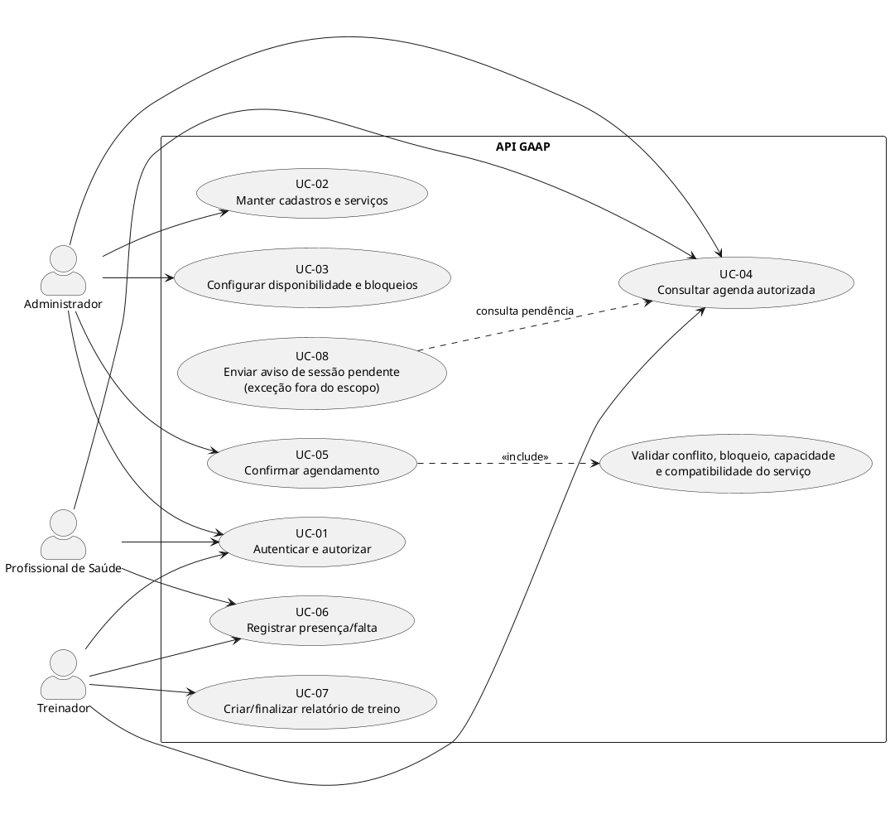

# Casos de Uso do GAAP

Este documento usa exclusivamente os perfis do cenário GAAP e rastreia os requisitos definidos em [LevReq](levreq.md). “Aula experimental”, “responsável legal”, “coordenação” e os fluxos de cancelamento/remarcação encontrados em artefatos anteriores não estão incluídos no MVP por não constarem no cenário atual; ver [Glossário](glossario.md).

## Atores

| Ator | Responsabilidade no cenário |
|---|---|
| Administrador | Mantém cadastros, serviços, horários e bloqueios, consulta pendências e solicita confirmação de sessões. |
| Treinador | Consulta agenda própria, registra presença/falta e cria/finaliza relatórios de treino. |
| Profissional de Saúde | Consulta atendimentos do seu serviço e agenda atribuída; registra presença/falta dos alunos desses atendimentos. |

## Casos de uso e rastreabilidade

| ID | Caso de uso | Ator primário | Requisitos |
|---|---|---|---|
| UC-01 | Autenticar e autorizar acesso | Todos | RF-01 |
| UC-02 | Manter alunos, profissionais e serviços | Administrador | RF-02 |
| UC-03 | Configurar disponibilidade e bloqueios | Administrador | RF-03 |
| UC-04 | Consultar agenda autorizada | Todos | RF-04 |
| UC-05 | Confirmar agendamento | Administrador | RF-03, RF-05 |
| UC-06 | Registrar presença/falta | Treinador ou Profissional de Saúde responsável | RF-06 |
| UC-07 | Criar e finalizar relatório de treino | Treinador | RF-07 |
| UC-08 | Receber aviso de sessão pendente por e-mail | Treinador | RF-08 (fora do escopo) |

## Diagrama de casos de uso

## UC-01 — Autenticar e autorizar acesso

- **Atores:** Administrador, Treinador e Profissional de Saúde.
- **Pré-condição:** perfil e credenciais cadastrados.
- **Fluxo principal:** usuário envia credenciais; API valida; API associa o perfil e permite somente as operações e os dados autorizados.
- **Alternativas:** credencial inválida resulta em 401; usuário autenticado sem autorização resulta em 403.
- **Pós-condição:** requisição autorizada ou negada sem exposição de dados indevidos.
- **Requisitos:** RF-01; RN-05; RNF-02, RNF-04.

## UC-02 — Manter alunos, profissionais e serviços

- **Ator:** Administrador.
- **Pré-condição:** Administrador autenticado e autorizado.
- **Fluxo principal:** Administrador cria, consulta ou atualiza um cadastro; API valida os campos e persiste os dados.
- **Alternativas:** perfil sem permissão recebe 403; payload inválido recebe 400 e identificação dos campos.
- **Pós-condição:** cadastro válido disponível para operações de agenda.
- **Requisitos:** RF-02; RNF-01, RNF-04.

## UC-03 — Configurar disponibilidade e bloqueios

- **Ator:** Administrador.
- **Pré-condição:** Administrador autenticado; profissional existente.
- **Fluxo principal:** Administrador informa profissional e faixa de disponibilidade ou bloqueio; API valida intervalo; registra a configuração e a exibe na agenda.
- **Alternativas:** intervalo inválido recebe 400; usuário sem permissão recebe 403.
- **Pós-condição:** regra de disponibilidade/bloqueio passa a ser considerada em novos agendamentos.
- **Requisitos:** RF-03; RN-03; RNF-04.

## UC-04 — Consultar agenda autorizada

- **Atores:** Administrador, Treinador e Profissional de Saúde.
- **Pré-condição:** usuário autenticado.
- **Fluxo principal:** usuário consulta um período; API restringe a resposta ao escopo do perfil: administrador consulta a operação, treinador consulta sessões sob sua responsabilidade e profissional de saúde consulta atendimentos de seu serviço e agenda.
- **Alternativas:** período inválido recebe 400; usuário não pode ampliar o escopo de acesso alterando filtros.
- **Pós-condição:** API retorna apenas registros autorizados.
- **Requisitos:** RF-04; RN-05; RNF-04.

## UC-05 — Confirmar agendamento

- **Ator:** Administrador.
- **Pré-condição:** Administrador autenticado; aluno, profissional e serviço cadastrados.
- **Fluxo principal:** Administrador informa serviço, profissional, intervalo e participantes; API valida payload, compatibilidade do profissional, disponibilidade, bloqueios, conflito e capacidade; persiste e confirma a sessão integralmente.
- **Alternativas:** qualquer falha resulta em erro observável, sem persistir sessão parcial; concorrência não pode ultrapassar a capacidade.
- **Pós-condição:** sessão confirmada e visível aos perfis autorizados.
- **Requisitos:** RF-03, RF-05; RN-01 a RN-04 e RN-06; RNF-01, RNF-03, RNF-04.
- **Diagrama:** [Confirmar agendamento](diagrama_de_sequencia.md#confirmar-agendamento).

## UC-06 — Registrar presença/falta

- **Atores:** Treinador responsável por sessão de Treino; Profissional de Saúde responsável por atendimento vinculado ao seu serviço e agenda.
- **Pré-condição:** sessão/atendimento existente; profissional autenticado e associado ao compromisso.
- **Fluxo principal:** profissional seleciona o compromisso e informa presença/falta por aluno participante; API valida os participantes e salva o resultado.
- **Alternativas:** profissional diferente do responsável recebe 403; participante inexistente ou situação inválida recebe 400/404.
- **Pós-condição:** presença/falta persistida por participante.
- **Requisitos:** RF-06; RN-05; RNF-04, RNF-05.

## UC-07 — Criar e finalizar relatório de treino

- **Ator:** Treinador responsável pela sessão.
- **Pré-condição:** sessão de Treino realizada e Treinador autorizado.
- **Fluxo principal:** Treinador cria um relatório associado à sessão, registra objetivo, exercícios executados, volume total com unidade e intensidade Borg CR10 (0–10), e pode salvá-lo como rascunho. Ao finalizar, a API valida os campos obrigatórios e associa o relatório à lista de participantes da sessão.
- **Alternativas:** perfil sem permissão recebe 403; sessão inexistente recebe 404; payload incompleto/inválido impede a finalização e recebe 400; rascunhos podem permanecer incompletos; relatório finalizado não pode ser alterado.
- **Pós-condição:** há no máximo um relatório por sessão; fica como rascunho ou finalizado e consultável por perfis autorizados.
- **Requisitos:** RF-07; RN-05, RN-06; RNF-01, RNF-03, RNF-04.
- **Diagrama:** [Finalizar relatório de treino](diagrama_de_sequencia.md#finalizar-relatorio-de-treino).

## UC-08 — Receber aviso por e-mail de sessão pendente

- **Ator:** Treinador com e-mail cadastrado; serviço de e-mail é ator externo.
- **Pré-condição:** sessão permanece agendada por 30 minutos após o fim previsto.
- **Fluxo principal:** tarefa agendada localiza sessões elegíveis; envia uma mensagem ao Treinador e registra o envio para evitar duplicidade.
- **Alternativa:** sem e-mail, o envio é ignorado e registrado no log.
- **Pós-condição:** aviso enviado uma única vez por sessão.
- **Requisito:** RF-08. **Fora do escopo do cenário, mantido por recomendação do professor em 14/10/2026.**

## Referências

- [Cenário GAAP](../Iniciacao/cenario.md)
- [Glossário](glossario.md)
- [Levantamento de Requisitos](levreq.md)
- [Tabela de rastreabilidade](rastreabilidade.md)
