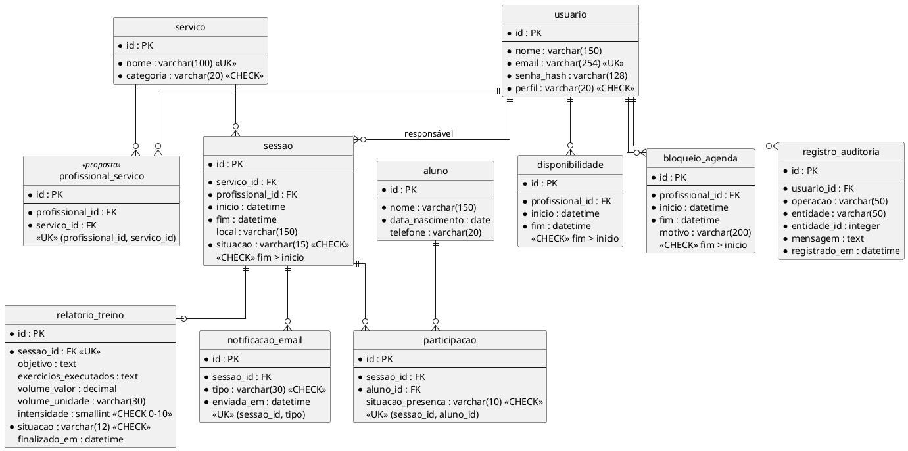

# Diagrama Entidade-Relacionamento do GAAP

Este DER traduz o [modelo conceitual](diagrama_de_classes.md) e o [levantamento de requisitos](levreq.md) em tabelas relacionais, como exige a seção 8 do [cenário](../Iniciacao/cenario.md). Ele descreve o **modelo-alvo**: as migrações atuais ainda são do domínio anterior (`Aluno`, `Professor`, `Sessao`), e a compatibilidade com as migrações será verificada quando a Construção 1 for implementada. Elementos marcados **(proposta)** dependem de decisões ainda abertas no [registro de decisões](revisao_cruzada.md#registro-de-decisoes-e-duvidas).

## Diagrama

## Tabelas e restrições

| Tabela | Chave e restrições | Índices para a agenda | Requisitos |
|---|---|---|---|
| usuario | `email` único; `perfil` restrito a ADMINISTRADOR, TREINADOR e PROFISSIONAL_SAUDE; senha guardada só como hash. | — | RF-01, RNF-02 |
| aluno | Campos compatíveis com o modelo `Aluno` atual. | — | RF-02 |
| servico | `nome` único; `categoria` restrita a TREINO, FISIOTERAPIA, PSICOLOGIA e NUTRICAO. | — | RF-02 |
| profissional_servico | Par `(profissional_id, servico_id)` único. Representa os serviços aos quais o profissional está vinculado. | `(servico_id)` | RN-04 |
| disponibilidade | `fim > inicio`. | `(profissional_id, inicio)` | RF-03, RN-03 |
| bloqueio_agenda | `fim > inicio`. | `(profissional_id, inicio)` | RF-03, RN-03 |
| sessao | `fim > inicio`; `situacao` restrita a AGENDADA, REALIZADA, NAO_REALIZADA e CANCELADA. | `(profissional_id, inicio, fim)`, `(inicio, fim)` | RF-04, RF-05, RF-09, RF-10, RF-11, RF-12, RN-01, RN-07 |
| notificacao_email | Par `(sessao_id, tipo)` único para evitar duplicidade por tipo de aviso. Tipos previstos: pendência de status (RF-08) e relatório de treino pendente (RF-12). | `(sessao_id, tipo)` | RF-08 (exceção fora do escopo), RF-12 |
| participacao | Par `(sessao_id, aluno_id)` único; `situacao_presenca` nula até o registro, depois PRESENTE ou FALTA. | `(aluno_id, sessao_id)` | RF-05, RF-06, RN-02, RN-07 |
| relatorio_treino | `sessao_id` único (um relatório por sessão); `intensidade` entre 0 e 10; `situacao` RASCUNHO ou FINALIZADO. | — | RF-07 |
| registro_auditoria | Somente inserção; a API não altera nem apaga registros. Mensagem legível por pessoas; sem senhas ou credenciais. | `(entidade, entidade_id)`, `(registrado_em)` | RNF-06 |

## Cardinalidades

- **usuario → sessao (1 : 0..N):** cada sessão tem exatamente um profissional responsável, e um profissional pode ter várias sessões. A restrição de perfil (Treinador ou Profissional de Saúde) é validada pela API, não pela chave.
- **servico → sessao (1 : 0..N):** cada sessão é de um único serviço.
- **usuario ↔ servico (N : N, via profissional_servico):** usuários com perfil profissional podem ter vários serviços vinculados; um serviço pode ter vários profissionais. Pedro Lucas confirmou em 03/11/2026 que o Treinador pode atuar em mais de um serviço. O perfil do usuário é um campo enumerado em `usuario`; não há tabelas de especialização.
- **sessao ↔ aluno (N : N, via participacao):** a participação guarda a presença de cada aluno. O limite máximo é de 6 alunos por sessão para qualquer serviço (RN-02).
- **sessao → relatorio_treino (1 : 0..1):** o relatório só existe para sessões de Treino, e a unicidade de `sessao_id` garante um por sessão.
- **disponibilidade e bloqueio_agenda → usuario (N : 1):** os períodos são gerais por profissional, conforme a D-06.

## Regras que o banco não garante sozinho

- **Sobreposição de horário (RN-01, RN-07) e bloqueios (RN-03):** uma restrição de unicidade não detecta intervalos que se sobrepõem. A API consulta e valida conflitos antes de gravar, na mesma transação, e retorna mensagem clara (por exemplo, “O profissional já possui um compromisso neste horário” ou “O aluno já possui um compromisso neste horário”). O índice composto `(profissional_id, inicio, fim)` apoia a busca profissional; para alunos, `(aluno_id, sessao_id)` em `participacao` e `(inicio, fim)` em `sessao` apoiam o join e os filtros de horário. O ganho real depende do banco e deve ser confirmado pelo plano de execução e medição. Em PostgreSQL, uma *exclusion constraint* pode também garantir a regra do profissional no banco.
- **Concorrência (RNF-03):** o projeto usa SQLite. No SQLite, o Django ignora o `select_for_update`, e a escrita bloqueia o banco inteiro. Isso evita a gravação simultânea, mas precisa ser comprovado pelo teste concorrente do RNF-03. Se o banco mudar para PostgreSQL, intervalos sobrepostos podem ser barrados por uma *exclusion constraint*.
- **Imutabilidade do relatório finalizado (RF-07):** é validada pela API, não por restrição de banco.

## Decisões de modelagem registradas no DER

| Decisão | Efeito no DER |
|---|---|
| D-01 capacidade | O limite de 6 alunos por sessão vale para qualquer serviço e será uma constante de validação no backend do MVP; não há coluna de capacidade em `servico` ou `sessao`. |
| D-08 relatório × Treinador | `relatorio_treino` pertence somente à sessão. O responsável profissional atual controla o rascunho; reatribuir a sessão não move o relatório. |
| D-09 perfis e serviços | `usuario.perfil` distingue os três perfis; profissionais podem ter vários serviços por meio de `profissional_servico`. |
| RNF-06 auditoria | `registro_auditoria` registra cadastro de usuário, confirmação de agendamento, alteração de presença/falta e finalização de relatório, com autoria, operação, entidade, data/hora e mensagem humana. É append-only e não armazena senhas ou credenciais. |

## Desvios em relação às migrações atuais

| Modelo atual (migrações 0001–0008) | DER-alvo |
|---|---|
| `Professor` com nome, e-mail e telefone | Substituído por `usuario` com perfil; a migração de dados é tarefa da Construção 1 (risco R-03). |
| `Sessao.titulo`, `descricao`, `observacoes` e `tipo` (TREINAMENTO/AVALIACAO) | O tipo dá lugar a `servico_id`; os demais campos não aparecem nos requisitos atuais. |
| Sem tabelas de serviço, disponibilidade, bloqueio, participação ou relatório | Criadas no DER-alvo. |
| `Sessao.notificacao_enviada_em` (RF-08) | A implementação atual usa essa coluna. O modelo-alvo a substitui pela tabela `notificacao_email`, que registra cada tipo de aviso e evita duplicidade também para RF-12. |

## Referências

- [Cenário GAAP — seções 4 e 8](../Iniciacao/cenario.md)
- [Diagrama de classes](diagrama_de_classes.md)
- [Levantamento de requisitos](levreq.md)
- [Registro de decisões](revisao_cruzada.md)
