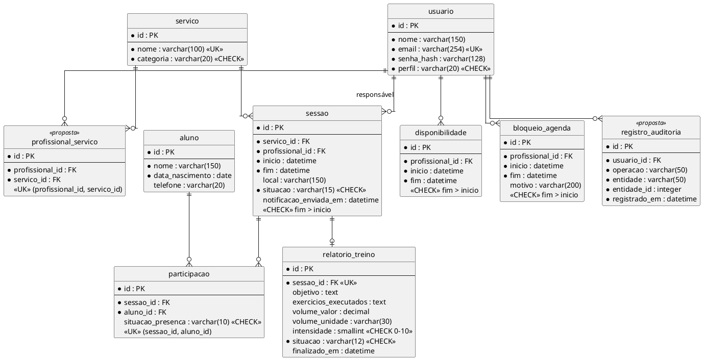

# Diagrama Entidade-Relacionamento do GAAP

Este DER traduz o [modelo conceitual](diagrama_de_classes.md) e o [levantamento de requisitos](levreq.md) em tabelas relacionais, como exige a seção 8 do [cenário](../Iniciacao/cenario.md). Ele descreve o **modelo-alvo**: as migrações atuais ainda são do domínio anterior (`Aluno`, `Professor`, `Sessao`), e a compatibilidade com as migrações será verificada quando a Construção 1 for implementada. Elementos marcados **(proposta)** dependem de decisões ainda abertas no [registro de decisões](revisao_cruzada.md#registro-de-decisoes-e-duvidas).

## Diagrama

## Tabelas e restrições

| Tabela | Chave e restrições | Índices para a agenda | Requisitos |
|---|---|---|---|
| usuario | `email` único; `perfil` restrito a ADMINISTRADOR, TREINADOR e PROFISSIONAL_SAUDE; senha guardada só como hash. | — | RF-01, RNF-02 |
| aluno | Campos compatíveis com o modelo `Aluno` atual. | — | RF-02 |
| servico | `nome` único; `categoria` restrita a TREINO, FISIOTERAPIA, PSICOLOGIA e NUTRICAO. | — | RF-02 |
| profissional_servico **(proposta)** | Par `(profissional_id, servico_id)` único. Representa a habilitação do profissional para o serviço. | `(servico_id)` | RN-04 |
| disponibilidade | `fim > inicio`. | `(profissional_id, inicio)` | RF-03, RN-03 |
| bloqueio_agenda | `fim > inicio`. | `(profissional_id, inicio)` | RF-03, RN-03 |
| sessao | `fim > inicio`; `situacao` restrita a AGENDADA, REALIZADA, NAO_REALIZADA e CANCELADA. | `(profissional_id, inicio)`, `(inicio)` | RF-04, RF-05, RN-01, RF-09 |
| participacao | Par `(sessao_id, aluno_id)` único; `situacao_presenca` nula até o registro, depois PRESENTE ou FALTA. | `(aluno_id)` | RF-05, RF-06, RN-02, RN-07 |
| relatorio_treino | `sessao_id` único (um relatório por sessão); `intensidade` entre 0 e 10; `situacao` RASCUNHO ou FINALIZADO. | — | RF-07 |
| registro_auditoria **(proposta)** | Somente inserção; a API não altera nem apaga registros. | `(entidade, entidade_id)` | RNF-06 |

## Cardinalidades

- **usuario → sessao (1 : 0..N):** cada sessão tem exatamente um profissional responsável, e um profissional pode ter várias sessões. A restrição de perfil (Treinador ou Profissional de Saúde) é validada pela API, não pela chave.
- **servico → sessao (1 : 0..N):** cada sessão é de um único serviço.
- **usuario ↔ servico (N : N, via profissional_servico):** um profissional pode estar habilitado para vários serviços, e um serviço pode ter vários profissionais. Ver D-09.
- **sessao ↔ aluno (N : N, via participacao):** a participação guarda a presença de cada aluno. Se a sessão admite um ou mais alunos depende da D-01.
- **sessao → relatorio_treino (1 : 0..1):** o relatório só existe para sessões de Treino, e a unicidade de `sessao_id` garante um por sessão.
- **disponibilidade e bloqueio_agenda → usuario (N : 1):** os períodos são gerais por profissional, conforme a D-06.

## Regras que o banco não garante sozinho

- **Sobreposição de horário (RN-01, RN-07) e bloqueios (RN-03):** uma restrição de unicidade não detecta intervalos que se sobrepõem. A verificação fica na API, dentro da mesma transação que grava a sessão (RN-06).
- **Concorrência (RNF-03):** o projeto usa SQLite. No SQLite, o Django ignora o `select_for_update`, e a escrita bloqueia o banco inteiro. Isso evita a gravação simultânea, mas precisa ser comprovado pelo teste concorrente do RNF-03. Se o banco mudar para PostgreSQL, intervalos sobrepostos podem ser barrados por uma *exclusion constraint*.
- **Imutabilidade do relatório finalizado (RF-07):** é validada pela API, não por restrição de banco.

## Decisões pendentes que afetam o DER

| Decisão | Efeito no DER |
|---|---|
| D-01 capacidade | Falta a coluna de capacidade. Ela vai em `servico` ou em `sessao`, conforme a resposta do professor. |
| A3 habilitação profissional–serviço | `profissional_servico` é proposta até o diagrama de classes incluir a associação. |
| D-08 relatório × Treinador | Hoje o relatório chega ao Treinador por `sessao.profissional_id`. Se o vínculo precisar ser direto, entra `relatorio_treino.treinador_id`. |
| D-09 perfis | Se Treinador e Profissional de Saúde virarem especializações, `usuario` se divide em tabelas próprias. |
| RNF-06 auditoria | `registro_auditoria` é proposta até a confirmação do nível de detalhe. |

## Desvios em relação às migrações atuais

| Modelo atual (migrações 0001–0008) | DER-alvo |
|---|---|
| `Professor` com nome, e-mail e telefone | Substituído por `usuario` com perfil; a migração de dados é tarefa da Construção 1 (risco R-03). |
| `Sessao.titulo`, `descricao`, `observacoes` e `tipo` (TREINAMENTO/AVALIACAO) | O tipo dá lugar a `servico_id`; os demais campos não aparecem nos requisitos atuais. |
| Sem tabelas de serviço, disponibilidade, bloqueio, participação ou relatório | Criadas no DER-alvo. |
| `Sessao.notificacao_enviada_em` (RF-08) | Mantida como coluna, compatível com a migração atual. O diagrama de classes representa o mesmo dado como a classe `NotificacaoEmail`. |

## Referências

- [Cenário GAAP — seções 4 e 8](../Iniciacao/cenario.md)
- [Diagrama de classes](diagrama_de_classes.md)
- [Levantamento de requisitos](levreq.md)
- [Registro de decisões](revisao_cruzada.md)
