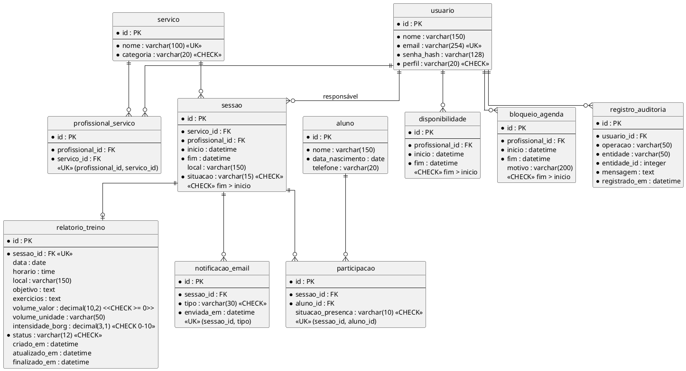

# Diagrama Entidade-Relacionamento do GAAP

Este DER traduz o [modelo conceitual](diagrama_de_classes.md) e o [levantamento de requisitos](levreq.md) em tabelas relacionais, como exige a seção 8 do [cenário](../Iniciacao/cenario.md). As migrações 0009–0017 criam o catálogo de serviços, usuários, vínculos profissional-serviço, configuração da agenda, participação dos alunos nas sessões e relatório de treino, convertem os antigos professores em usuários com perfil Treinador e simplificam os logins internos gerados nessa conversão. A migração 0012 também transfere a responsabilidade pelas sessões para `Usuario`; o modelo e a tabela `Professor` deixam de ser usados. A migração é interrompida se houver conflito de e-mail ou do login de destino, para não associar registros à conta errada. As diferenças entre o DER e as migrações estão em [Desvios em relação às migrações atuais](#desvios-em-relacao-as-migracoes-atuais). As escolhas de modelagem seguem o [registro de decisões](revisao_cruzada.md#registro-de-decisoes-e-duvidas).

## Diagrama

## Tabelas e restrições

| Tabela | Chave e restrições | Índices para a agenda | Requisitos |
|---|---|---|---|
| usuario | `email` único; `perfil` restrito a ADMINISTRADOR, TREINADOR e PROFISSIONAL_SAUDE; senha guardada só como hash. | — | RF-01, RNF-02 |
| aluno | Campos compatíveis com o modelo `Aluno` atual. | — | RF-02 |
| servico | `nome` único; `categoria` restrita a TREINO, FISIOTERAPIA, PSICOLOGIA e NUTRICAO. | — | RF-02 |
| profissional_servico | Par `(profissional_id, servico_id)` único. Representa os serviços aos quais o profissional está vinculado. | `(servico_id)` | RN-04 |
| disponibilidade | Profissional, início, fim; `fim > inicio`. | `(profissional_id, inicio)` | RF-03, RN-03 |
| bloqueio_agenda | Profissional, início, fim e motivo opcional de até 200 caracteres; `fim > inicio`. | `(profissional_id, inicio)` | RF-03, RN-03 |
| sessao | `fim > inicio`; `situacao` restrita a AGENDADA, REALIZADA, NAO_REALIZADA e CANCELADA. | `(profissional_id, inicio, fim)`, `(inicio, fim)` | RF-04, RF-05, RF-09, RF-10, RF-11, RF-12, RN-01, RN-07 |
| notificacao_email | Par `(sessao_id, tipo)` único para evitar duplicidade por tipo de aviso. Tipos previstos: pendência de status (RF-08) e relatório de treino pendente (RF-12). | `(sessao_id, tipo)` | RF-08 (exceção fora do escopo), RF-12 |
| participacao | Par `(sessao_id, aluno_id)` único; `situacao_presenca` nula até o registro, depois PRESENTE ou FALTA. | `(aluno_id, sessao_id)` | RF-05, RF-06, RN-02, RN-07 |
| relatorio_treino | `sessao_id` único (um relatório por sessão); `volume_valor` não negativo; `intensidade_borg` entre 0 e 10; `status` RASCUNHO ou FINALIZADO. Participantes são consultados por `sessao_id`. | — | RF-07 |
| registro_auditoria | Somente inserção; a API não altera nem apaga registros. Mensagem legível por pessoas; sem senhas ou credenciais. | `(entidade, entidade_id)`, `(registrado_em)` | RNF-06 |

## Cardinalidades

- **usuario → sessao (1 : 0..N):** cada sessão tem exatamente um profissional responsável, e um profissional pode ter várias sessões. A restrição de perfil (Treinador ou Profissional de Saúde) é validada pela API, não pela chave.
- **servico → sessao (1 : 0..N):** cada sessão é de um único serviço.
- **usuario ↔ servico (N : N, via profissional_servico):** usuários com perfil profissional podem ter vários serviços vinculados; um serviço pode ter vários profissionais. Pedro Lucas confirmou em 03/11/2026 que o Treinador pode atuar em mais de um serviço. O perfil do usuário é um campo enumerado em `usuario`; não há tabelas de especialização.
- **sessao ↔ aluno (N : N, via participacao):** a participação guarda a presença de cada aluno. O limite máximo é de 6 alunos por sessão para qualquer serviço (RN-02).
- **sessao → relatorio_treino (1 : 0..1):** o relatório só existe para sessões de Treino, e a unicidade de `sessao_id` garante um por sessão.
- **disponibilidade e bloqueio_agenda → usuario (N : 1):** os períodos são gerais por profissional, conforme a D-06.

## Regras que o banco não garante sozinho

- **Sobreposição de horário (RN-01, RN-07) e bloqueios (RN-03):** uma restrição de unicidade não detecta intervalos que se sobrepõem. A API consulta e valida conflitos antes de gravar, na mesma transação, e retorna mensagem clara (por exemplo, “O profissional já possui um compromisso neste horário” ou “O aluno já possui um compromisso neste horário”). O índice composto `(profissional_id, inicio, fim)` apoia a busca profissional; para alunos, `(aluno_id, sessao_id)` em `participacao` e `(inicio, fim)` em `sessao` apoiam o join e os filtros de horário. O ganho real depende do banco e deve ser confirmado pelo plano de execução e medição. Em PostgreSQL, uma *exclusion constraint* pode também garantir a regra do profissional no banco.
- **Concorrência (RNF-03):** o projeto usa SQLite. No SQLite, o Django ignora o `select_for_update`, e a escrita bloqueia o banco inteiro. Para que duas confirmações não validem a mesma agenda, a conexão usa `transaction_mode` `IMMEDIATE`: cada transação reserva a escrita ao começar, e a segunda confirmação espera a primeira terminar antes de validar. O teste concorrente da #99 comprova a regra: sem esse modo, a segunda confirmação falha com "database is locked"; com ele, recebe a recusa da regra. A confirmação também chama `select_for_update` no profissional e nos alunos, que passa a travar as linhas se o banco mudar para PostgreSQL. Nesse caso, intervalos sobrepostos também podem ser barrados por uma *exclusion constraint*.
- **Capacidade (RN-02):** o limite de 6 alunos é a constante `CAPACIDADE_MAXIMA_SESSAO` do backend, verificada na confirmação. Como a sessão é gravada junto com todos os participantes e eles não podem ser alterados depois, não há como duas requisições somarem alunos na mesma sessão.
- **Imutabilidade do relatório finalizado (RF-07):** é validada pela API, não por restrição de banco.

## Decisões de modelagem registradas no DER

| Decisão | Efeito no DER |
|---|---|
| D-01 capacidade | O limite de 6 alunos por sessão vale para qualquer serviço e será uma constante de validação no backend do MVP; não há coluna de capacidade em `servico` ou `sessao`. |
| D-08 relatório × Treinador | `relatorio_treino` pertence somente à sessão. O responsável profissional atual controla o rascunho; reatribuir a sessão não move o relatório. |
| D-09 perfis e serviços | `usuario.perfil` distingue os três perfis; profissionais podem ter vários serviços por meio de `profissional_servico`. |
| RNF-06 auditoria | `registro_auditoria` registra cadastro de usuário, confirmação de agendamento, alteração de presença/falta e finalização de relatório, com autoria, operação, entidade, data/hora e mensagem humana. É append-only e não armazena senhas ou credenciais. |

## Desvios em relação às migrações atuais

| Modelo atual (migrações 0001–0017) | DER-alvo |
|---|---|
| `Professor` com nome, e-mail e telefone | Migração 0012 converte cada registro em `usuario` com perfil Treinador, preserva contato e redireciona as sessões. A migração 0017 usa `usuario` para o registro legado de ID 1 e `usuario-{id}` para os demais; a senha continua inutilizável até um Administrador definir uma. |
| `Sessao.titulo`, `descricao`, `observacoes` e `tipo` (TREINAMENTO/AVALIACAO) | O tipo dá lugar a `servico_id`; os demais campos não aparecem nos requisitos atuais. |
| `Sessao.servico` e `Sessao.profissional` obrigatórios (migração 0015) | Iguais ao DER. As colunas ficaram opcionais nas migrações 0012 e 0014 por causa das sessões antigas, sem professor ou sem serviço. A 0015 torna as duas obrigatórias e é interrompida, sem alterar dados, se ainda houver sessão sem serviço ou sem profissional. Como `PROTECT`, a API recusa com `409` a remoção de um serviço ou de um profissional que tenha sessões. |
| Índices `(profissional_id, inicio, fim)` e `(inicio, fim)` em `sessao` (migração 0014) | Iguais aos previstos no DER para a busca de conflitos. |
| `Sessao.status` sem a coluna `local` | O DER chama a coluna de `situacao` e prevê `local` na sessão; no código, data, horário e local ficam no relatório de treino. Os valores do status são os mesmos: AGENDADA, REALIZADA, NAO_REALIZADA e CANCELADA. |
| Restrições `CHECK` de `usuario.perfil`, `sessao.situacao` e `fim > inicio` | Nas migrações, o perfil e o status são validados pelas opções do modelo no Django, e `fim > inicio` pelo serializer da sessão; o banco não tem essas restrições. Só `servico.categoria` tem restrição no banco (migração 0009). |
| Profissional com sessões (#88) | Como `Sessao.profissional` é `PROTECT`, a API recusa com `409` a remoção de um profissional responsável por sessões, e o modelo recusa mudar o perfil dele para Administrador. As sessões precisam ser transferidas antes. |
| `Servico` com `nome` único e categoria restrita às quatro áreas (migração 0009) | Igual à tabela `servico` do DER. |
| `ProfissionalServico` com o par `(profissional_id, servico_id)` único (migração 0011) | Igual à tabela `profissional_servico` do DER. A restrição de perfil (só Treinador e Profissional de Saúde) é validada pela aplicação, não pelo banco, porque o perfil fica em outra tabela. |
| Tabelas de disponibilidade e bloqueio de agenda | Migração 0013 implementa os períodos gerais por profissional; a API valida `fim > inicio` e o banco protege a mesma regra. |
| `Participacao` com o par `(sessao_id, aluno_id)` único, índice `(aluno_id, sessao_id)` e `situacao_presenca` nula, PRESENTE ou FALTA (migração 0014) | Igual à tabela `participacao` do DER; a restrição da presença também está no banco. Remover a sessão remove as participações; o aluno é `PROTECT` para preservar o histórico de presença, e a API recusa com `409` a remoção de um aluno que participe de sessões. O limite de 6 alunos (RN-02) é validado na confirmação, não no banco. |
| `RelatorioTreino` (migração 0016) | Implementa um rascunho por sessão com data, horário, local, objetivo, exercícios, volume, unidade, intensidade Borg, situação e timestamps. Participantes são derivados das participações da sessão. Finalização completa e imutabilidade são validadas pela API. |
| `NotificacaoEmail` (migração 0018) | Igual à tabela `notificacao_email` do DER, com o par `(sessao_id, tipo)` único. Por enquanto só o lembrete de relatório (RF-12) usa a tabela. |
| `RegistroAuditoria` (migração 0019) | Igual à tabela `registro_auditoria` do DER, com os índices `(entidade, entidade_id)` e `(registrado_em)`. A FK `usuario` é opcional (`SET_NULL`) e há uma coluna `autor` com o nome no momento da operação, para manter a autoria do superusuário sem perfil GAAP e de usuários removidos. |
| `Sessao.notificacao_enviada_em` (RF-08) | O aviso de status pendente (RF-08) continua usando essa coluna. Passá-lo para `notificacao_email` fica para outra issue, para não misturar a mudança com o RF-12. |
| `usuario` com `senha_hash` na própria tabela | A migração 0010 criou `usuario` com nome, e-mail, telefone e perfil, e ligou cada registro ao usuário do Django, que guarda o login e o hash da senha. O motivo é de migração, não de modelagem: trocar o `AUTH_USER_MODEL` depois que as migrações de `auth` e `admin` já foram aplicadas interrompe o `migrate` no banco da VPS, o que foi reproduzido antes da escolha. O comportamento previsto no DER — perfil único por usuário e senha somente em hash — é preservado. |

## Referências

- [Cenário GAAP — seções 4 e 8](../Iniciacao/cenario.md)
- [Diagrama de classes](diagrama_de_classes.md)
- [Levantamento de requisitos](levreq.md)
- [Registro de decisões](revisao_cruzada.md)
