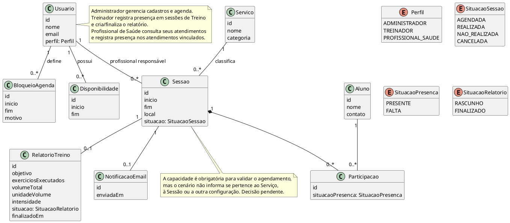

# Modelo Conceitual do Domínio GAAP

Este é o modelo conceitual proposto a partir do cenário GAAP e dos requisitos RF/RN. Ele não descreve a implementação atual: o código ainda contém `Aluno`, `Professor` e `Sessao`, sem os cadastros de serviço, disponibilidade, bloqueios, presença individual ou relatório de treino. As cardinalidades e a localização da capacidade precisam de validação do responsável pelo cenário.

## Diagrama

## Responsabilidades e rastreabilidade

| Conceito | Responsabilidade | Requisitos | Casos de uso |
|---|---|---|---|
| Usuario | Identidade, perfil e autorização. | RF-01, RN-05, RNF-02, RNF-04 | UC-01, UC-04, UC-06, UC-07 |
| Aluno | Pessoa atendida e participante de sessão. | RF-02, RF-05, RF-06 | UC-02, UC-05, UC-06 |
| Servico | Categoria Treino, Fisioterapia, Psicologia ou Nutrição. | RF-02, RF-05, RN-04 | UC-02, UC-05 |
| Disponibilidade | Faixa geral da agenda do profissional, compartilhada entre seus serviços habilitados. | RF-03, RF-05, RN-03 | UC-03, UC-05 |
| BloqueioAgenda | Intervalo geral indisponível em todos os serviços do profissional. | RF-03, RF-05, RN-03 | UC-03, UC-05 |
| Sessao | Ocorrência agendada de um serviço. | RF-04, RF-05, RN-01 a RN-04, RN-06 | UC-04, UC-05 |
| Participacao | Vínculo aluno–sessão/atendimento e presença/falta individual. | RF-05, RF-06, RN-02, RN-06 | UC-05, UC-06 |
| RelatorioTreino | Um relatório imutável após finalização por sessão de Treino, associado ao Treinador e à lista de participantes da sessão. Registra objetivo, exercícios, volume (valor e unidade), intensidade Borg CR10 (0–10) e situação rascunho/finalizado; data, horário e local vêm da sessão. | RF-07, RN-05, RN-06 | UC-07 |
| NotificacaoEmail | Marca o aviso excepcional enviado para a sessão. | RF-08 (fora do escopo) | UC-08 |

## Decisões pendentes

- Definir a entidade e o nível de configuração da capacidade.
- Definir a distinção entre Treinador e Profissional de Saúde no cadastro (perfil único com tipo ou especialização de usuário).

## Referências

- [Glossário do domínio](glossario.md)
- [Levantamento de Requisitos](levreq.md)
- [Casos de Uso](casos_de_uso.md)
- [Cenário GAAP](../Iniciacao/cenario.md)
