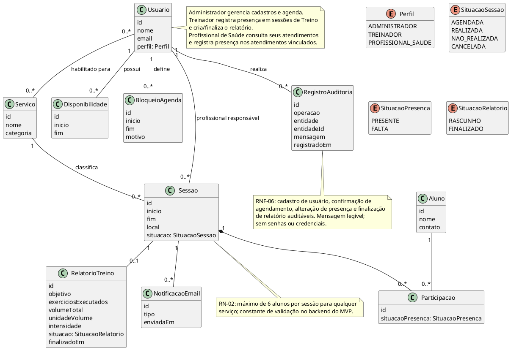

# Modelo Conceitual do Domínio GAAP

Este é o modelo conceitual proposto a partir do cenário GAAP e dos requisitos RF/RN. O código atual implementa `Aluno`, `Usuario`, `Servico`, `ProfissionalServico`, `Disponibilidade`, `BloqueioAgenda`, `Sessao` e `Participacao`, incluindo a consulta de agenda com escopo por perfil. `RelatorioTreino` e `RegistroAuditoria` continuam no modelo-alvo, mas ainda não têm implementação. A notificação RF-08 é implementada por `Sessao.notificacao_enviada_em` e pelo comando de notificação; `NotificacaoEmail` no diagrama é uma evolução do modelo, não uma classe atual. O professor informou capacidade máxima de 6 alunos por sessão para qualquer serviço; no MVP, a validação usa uma constante no backend.

## Diagrama

## Responsabilidades e rastreabilidade

| Conceito | Responsabilidade | Requisitos | Casos de uso |
|---|---|---|---|
| Usuario | Identidade, perfil, autorização e autoria das operações auditáveis. | RF-01, RN-05, RNF-02, RNF-04, RNF-06 | UC-01, UC-02, UC-04, UC-06, UC-07, UC-10 |
| Aluno | Pessoa atendida e participante de sessão; seus compromissos são consultados para evitar sobreposição. | RF-02, RF-05, RF-06, RN-07 | UC-02, UC-05, UC-06 |
| Servico | Categoria Treino, Fisioterapia, Psicologia ou Nutrição. | RF-02, RF-05, RN-04 | UC-02, UC-05 |
| Disponibilidade | Faixa geral da agenda do profissional, compartilhada entre seus serviços habilitados. | RF-03, RF-05, RN-03 | UC-03, UC-05 |
| BloqueioAgenda | Intervalo geral indisponível em todos os serviços do profissional. | RF-03, RF-05, RN-03 | UC-03, UC-05 |
| Sessao | Ocorrência agendada de um serviço, com situação realizada/não realizada; fonte das pendências e dos indicadores operacionais. | RF-04, RF-05, RF-09, RF-10, RF-11, RN-01 a RN-04, RN-06, RN-07 | UC-04, UC-05, UC-09, UC-10, UC-11 |
| Participacao | Vínculo aluno–sessão/atendimento e presença/falta individual; permite verificar conflito do aluno e pendências de presença. | RF-05, RF-06, RF-09, RN-02, RN-06, RN-07 | UC-05, UC-06, UC-09 |
| RelatorioTreino | Um relatório por sessão de Treino, imutável após finalização e ligado à sessão, não diretamente ao usuário. O Treinador responsável atual edita o rascunho; reatribuições não movem o relatório. Registra participantes, objetivo, exercícios, volume (valor e unidade), intensidade Borg CR10 (0–10) e situação; data, horário e local vêm da sessão. | RF-07, RF-09, RN-05 | UC-07, UC-09 |
| NotificacaoEmail | Marca avisos enviados para a sessão e evita duplicidade. | RF-08 (exceção fora do escopo), RF-12 | UC-08, UC-12 |
| RegistroAuditoria | Registro somente de inclusão da autoria, operação, entidade, data/hora e mensagem legível por pessoas; não inclui senhas ou credenciais. | RNF-06 | UC-02, UC-05, UC-06, UC-07, UC-10 |

O dashboard simples (RF-11) é uma consulta agregada das sessões por serviço e situação para um período; não exige classe de domínio específica.

## Referências

- [Glossário do domínio](glossario.md)
- [Levantamento de Requisitos](levreq.md)
- [Casos de Uso](casos_de_uso.md)
- [Cenário GAAP](../Iniciacao/cenario.md)
