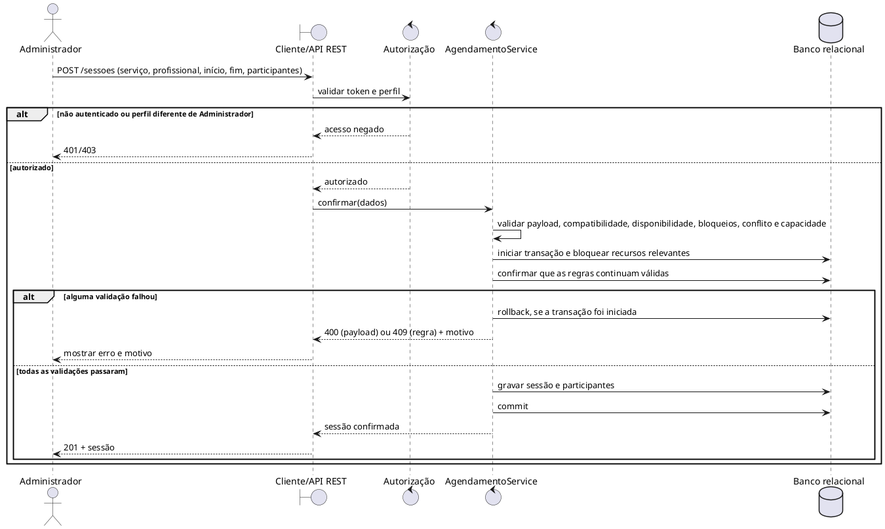
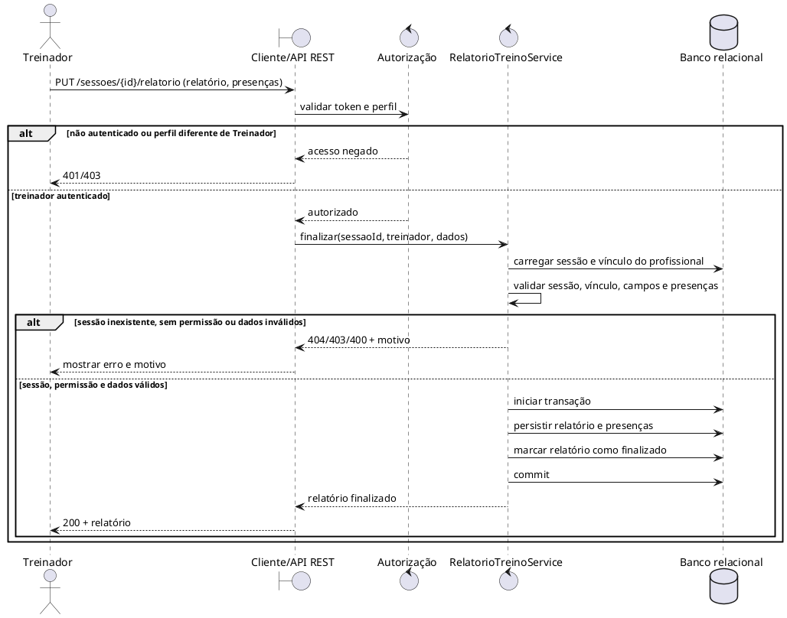

# Diagramas de Sequência dos Fluxos Críticos

Os diagramas usam os perfis e IDs definidos no [levantamento de requisitos](levreq.md). Como o cenário deixa regras e entidades em branco, detalhes marcados como proposta precisam de validação do responsável pelo cenário. Os participantes representam responsabilidades lógicas; não afirmam a arquitetura de classes atual.

## Confirmar agendamento

**Ator:** Administrador. **Requisitos:** RF-03, RF-05. **Regras:** RN-01 a RN-04 e RN-06. **Resultado:** a sessão é confirmada integralmente ou a operação é recusada sem persistência parcial.

O bloco de validação cobre os campos obrigatórios e intervalo (400), compatibilidade do profissional (RN-04), bloqueio e sobreposição de horários (RN-01, RN-03) e capacidade máxima (RN-02). Uma falha informa o motivo específico e não grava uma sessão parcial. A confirmação usa transação para impedir que solicitações concorrentes ultrapassem a capacidade (RN-06).

**Decisões a confirmar:** qual é o limite de capacidade e se sessões podem ser em grupo (cliente/responsável pelo cenário). A disponibilidade e os bloqueios já foram definidos como gerais por profissional, compartilhados entre serviços; a compatibilidade do profissional com cada serviço é verificada separadamente.

## Finalizar relatório de treino

**Ator:** Treinador responsável. **Requisitos:** RF-01, RF-06, RF-07. **Regra:** RN-05. **Resultado:** relatório associado à sessão de Treino é finalizado apenas pelo Treinador autorizado e com os dados obrigatórios válidos. Para atendimentos de saúde, o Profissional de Saúde responsável registra presença/falta pelo fluxo UC-06.

**Definições:** um relatório por sessão, com participantes vinculados à sessão; pode ser salvo como rascunho e finalizado após validação. Registra objetivo, exercícios executados, volume como valor + unidade e intensidade da sessão pela escala Borg CR10 (0–10). Para treino resistido, volume-carga pode ser calculado como séries × repetições × carga em kg; modalidades diferentes mantêm suas próprias unidades, sem somar medidas incompatíveis. Após finalização, o relatório é imutável e qualquer tentativa de edição deve ser recusada. Presença/falta também se aplica aos atendimentos de saúde, registrada pelo profissional responsável; esse fluxo é descrito no UC-06.

## Rastreabilidade

| Fluxo | Casos de Uso | Requisitos | Regras |
|---|---|---|---|
| Confirmar agendamento | UC-05 | RF-03, RF-05 | RN-01, RN-02, RN-03, RN-04, RN-06 |
| Finalizar relatório de treino | UC-07 | RF-01, RF-06, RF-07 | RN-05 |
