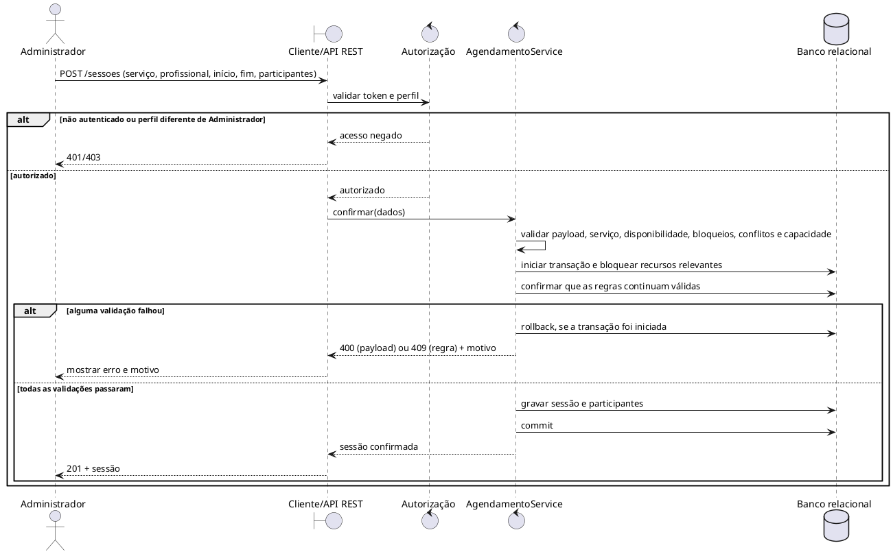
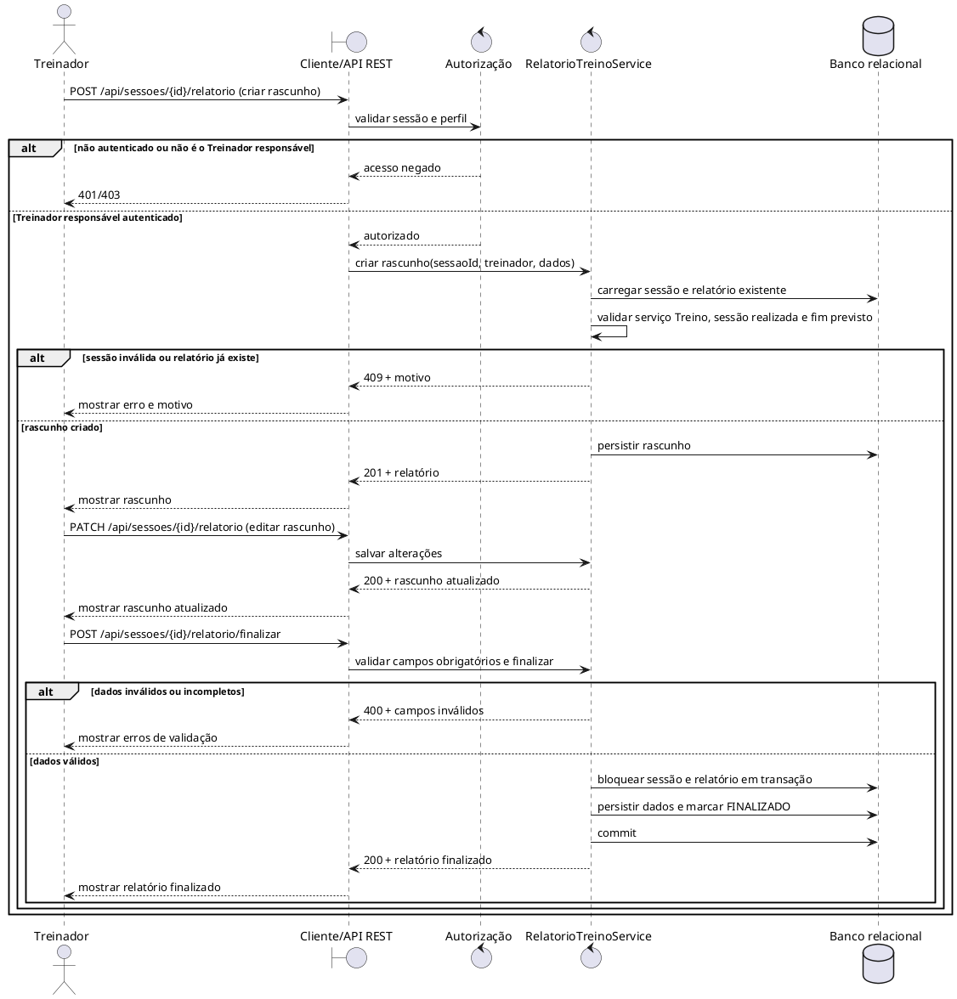

# Diagramas de Sequência dos Fluxos Críticos

Os diagramas usam os perfis e IDs definidos no [levantamento de requisitos](levreq.md). Como o cenário deixa regras e entidades em branco, detalhes marcados como proposta precisam de validação do responsável pelo cenário. Os participantes representam responsabilidades lógicas; não afirmam a arquitetura de classes atual.

## Confirmar agendamento

**Ator:** Administrador. **Requisitos:** RF-03, RF-05. **Regras:** RN-01 a RN-04, RN-06 e RN-07. **Resultado:** a sessão é confirmada integralmente ou a operação é recusada sem persistência parcial.

O bloco de validação cobre os campos obrigatórios e intervalo (400), compatibilidade do profissional (RN-04), bloqueios e disponibilidade (RN-03), sobreposição de horários do profissional (RN-01) e dos alunos participantes (RN-07), além da capacidade máxima informada de 6 alunos (RN-02). Conflitos retornam mensagem clara para o profissional ou aluno e não gravam sessão. A confirmação usa transação para impedir que solicitações concorrentes ultrapassem a capacidade (RN-06).

**Regra definida:** a validação de capacidade aplica o máximo de 6 alunos por sessão a qualquer serviço, por meio de uma constante no backend do MVP. A disponibilidade e os bloqueios são gerais por profissional, compartilhados entre serviços; a compatibilidade do profissional com cada serviço é verificada separadamente.

## Finalizar relatório de treino

**Ator:** Treinador responsável. **Requisitos:** RF-01, RF-07. **Regra:** RN-05. **Resultado:** relatório associado à sessão de Treino é finalizado apenas pelo Treinador autorizado, depois do fim previsto e com os dados obrigatórios válidos. O registro de presença/falta é uma operação separada (RF-06, UC-06), tanto para Treino quanto para atendimentos de saúde.

**Definições:** um relatório por sessão, com participantes vinculados à sessão; pode ser salvo como rascunho e finalizado após validação. Registra data, horário, local, objetivo, exercícios executados, volume como valor + unidade e intensidade da sessão pela escala Borg CR10 (0–10). Para treino resistido, volume-carga pode ser calculado como séries × repetições × carga em kg; modalidades diferentes mantêm suas próprias unidades, sem somar medidas incompatíveis. Após finalização, o relatório é imutável e qualquer tentativa de edição deve ser recusada com 409. Presença/falta é registrada separadamente pelo profissional responsável no UC-06.

## Rastreabilidade

| Fluxo | Casos de Uso | Requisitos | Regras |
|---|---|---|---|
| Confirmar agendamento | UC-05 | RF-03, RF-05 | RN-01, RN-02, RN-03, RN-04, RN-06, RN-07 |
| Finalizar relatório de treino | UC-07 | RF-01, RF-07 | RN-05 |
