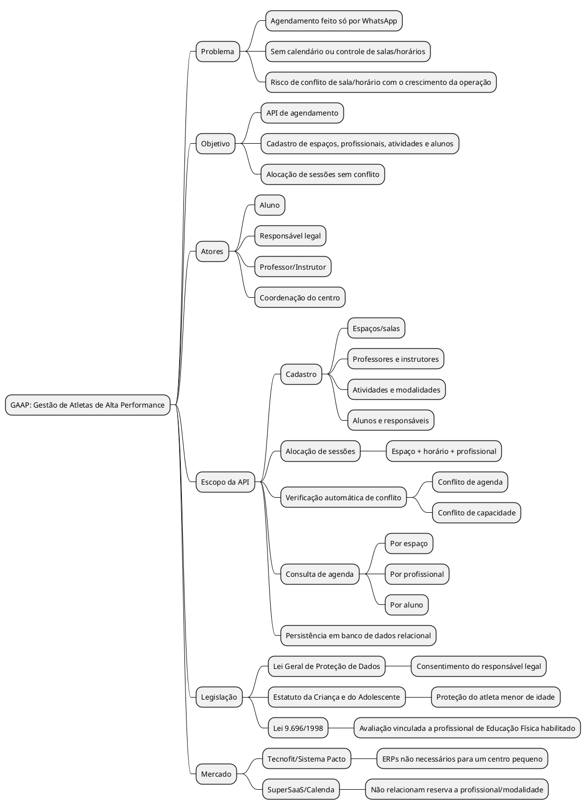
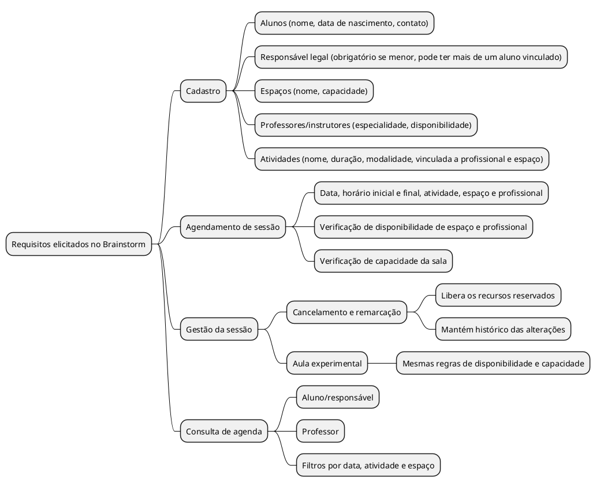

## Introdução

Mapa mental consiste em criar resumos cheios de símbolos, cores, setas e frases de efeito com o objetivo de organizar o conteúdo e facilitar associações entre as informações destacadas. Esse material é muito indicado para pessoas que têm facilidade de aprender de forma visual.

## Metodologia

O documento foi elaborado por Pedro Lucas, com base no levantamento já registrado em <a href="pesquisa.md">pesquisa.md</a> e nas propostas elicitadas em <a href="Brainstorm.md">Brainstorm.md</a>. Os mapas mentais registram a compreensão inicial do projeto e precisam ser revalidados contra o cenário GAAP.

## Mapa mental - Geral

### Mapa mental 1

### Mapa mental 2

## Conclusão

O mapa mental 1 organizou visualmente a compreensão inicial do problema, do objetivo da API e do escopo. O mapa mental 2 organizou as propostas elicitadas na sessão de Brainstorm. Como ambos foram produzidos antes da adoção do cenário GAAP, seus atores e requisitos precisam ser revalidados antes de servirem de base para o levantamento atualizado.

## Referências
> PlantUML Mindmap Diagram. Disponível em: https://plantuml.com/mindmap-diagram

## Versionamento
| Data | Versão | Descrição | Autor(es) |
| -- | -- | -- | -- |
| 08/09/26 | 1.0 | Criação do documento | Pedro Lucas |
