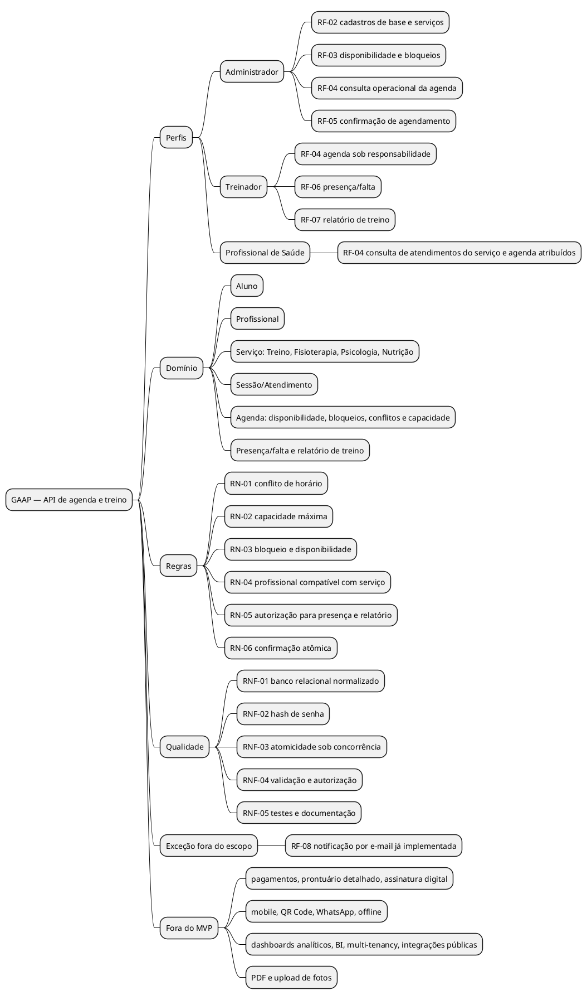

# Mapa Mental — GAAP

Mapa revisado conforme o cenário GAAP. Os IDs remetem ao [levantamento de requisitos](../Elaboracao/levreq.md); termos estão definidos no [glossário](../Elaboracao/glossario.md).

## Referências

- [Cenário GAAP](cenario.md)
- [Documento de Visão](documento_de_visao.md)
- [Glossário](../Elaboracao/glossario.md)
- [Levantamento de Requisitos](../Elaboracao/levreq.md)
