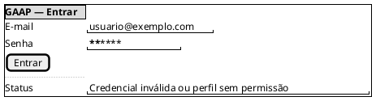
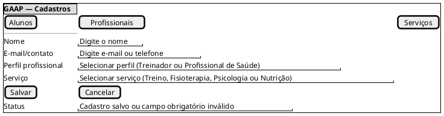
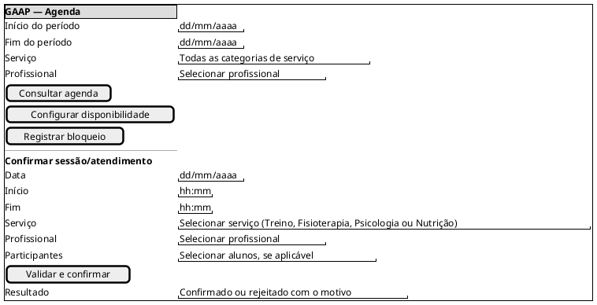
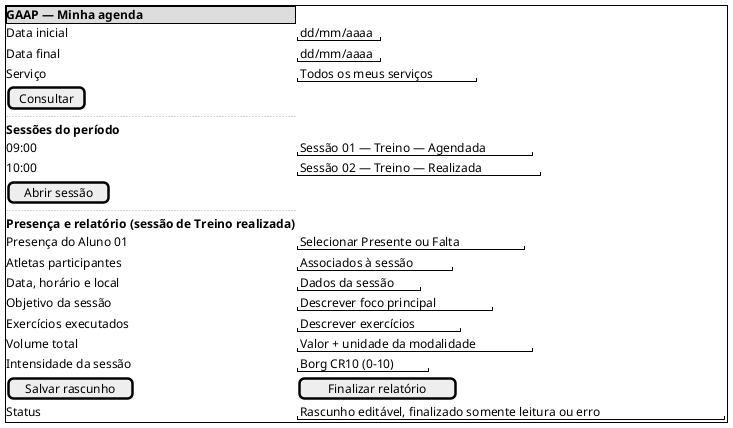
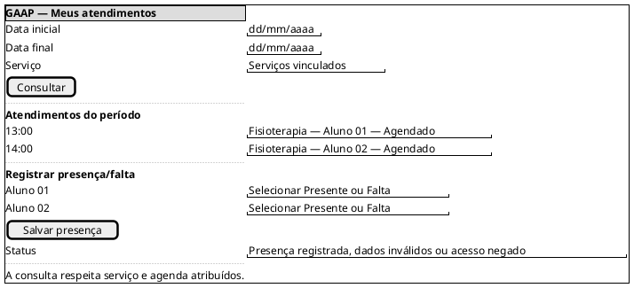

# Protótipo de Baixa Fidelidade — GAAP

Este protótipo de navegação usa os perfis do cenário GAAP e os IDs RF do [levantamento](../Elaboracao/levreq.md). É uma proposta de telas para uma API consumida por cliente web; a interface não faz parte da entrega do backend. Campos ainda não definidos pelo cenário estão identificados como pendentes.

## Mapa das telas

| Tela | Perfil | Requisitos | Ações principais |
|---|---|---|---|
| Acesso | Todos | RF-01 | Autenticar; apresentar acesso negado. |
| Cadastros | Administrador | RF-02 | Manter aluno, profissional e serviço. |
| Agenda e configuração | Administrador | RF-03, RF-04, RF-05 | Consultar disponibilidade/bloqueios e confirmar agendamento. |
| Agenda pessoal | Treinador | RF-04 | Consultar sessões sob sua responsabilidade. |
| Atendimentos | Profissional de Saúde | RF-04, RF-06 | Consultar apenas serviço e agenda atribuídos; registrar presença/falta dos alunos atendidos. |
| Presença e relatório | Treinador; Profissional de Saúde (presença nos atendimentos) | RF-06, RF-07 | Registrar presença/falta em sessões e atendimentos; Treinador finaliza relatório de treino. |
| Aviso de sessão pendente | Treinador | RF-08 (fora do escopo) | Receber o aviso excepcional por e-mail. |

## Acesso — RF-01

## Cadastros — Administrador — RF-02

## Agenda e confirmação — Administrador — RF-03, RF-04, RF-05

## Agenda do Treinador — RF-04, RF-06, RF-07

## Atendimentos do Profissional de Saúde — RF-04, RF-06

## Referência visual — protótipo de alta fidelidade

As telas abaixo são os exports atuais de alta fidelidade. Os wireframes PlantUML acima continuam sendo a referência de baixa fidelidade; as imagens não alteram o escopo nem resolvem as decisões ainda pendentes. **Os exports ainda não mostram o registro de presença/falta nos atendimentos de saúde nem todos os campos e estados definidos para o relatório de treino.** O arquivo editável está no [Figma](https://www.figma.com/design/7a3PVqNYNlwLtSgN4sfiU4/GAAP-%E2%80%94-Prot%C3%B3tipo-de-alta-fidelidade).

=== "Desktop · 1920 × 1080"

    ### Acesso

    { width="100%" }

    ### Visão geral

    { width="100%" }

    ### Cadastros

    { width="100%" }

    ### Novo agendamento

    { width="100%" }

    ### Agenda do treinador

    { width="100%" }

    ### Atendimentos de saúde

    { width="100%" }

=== "Mobile · 390 × 844"

    ### Acesso

    { width="390" }

    ### Visão geral

    { width="390" }

    ### Cadastros

    { width="390" }

    ### Novo agendamento

    { width="390" }

    ### Agenda do treinador

    { width="390" }

    ### Atendimentos de saúde

    { width="390" }

## Decisões que afetam as telas

- Definir onde a capacidade é configurada e se sessões comportam múltiplos alunos.
- Após a finalização, o relatório fica bloqueado para edição; rascunhos podem ser alterados antes de finalizar.
- A interface é representativa; a experiência visual não foi validada com usuários.
- A notificação por e-mail é RF-08, uma exceção registrada fora do escopo no cenário GAAP.

## Referências

- [Glossário](../Elaboracao/glossario.md)
- [Documento de Visão](documento_de_visao.md)
- [Levantamento de Requisitos](../Elaboracao/levreq.md)
- [Casos de Uso](../Elaboracao/casos_de_uso.md)
