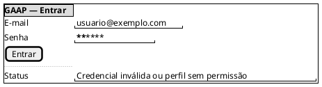
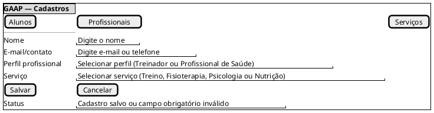
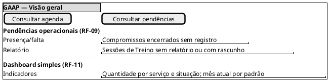
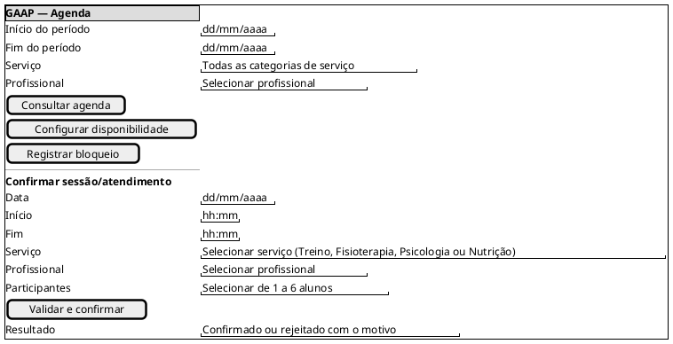
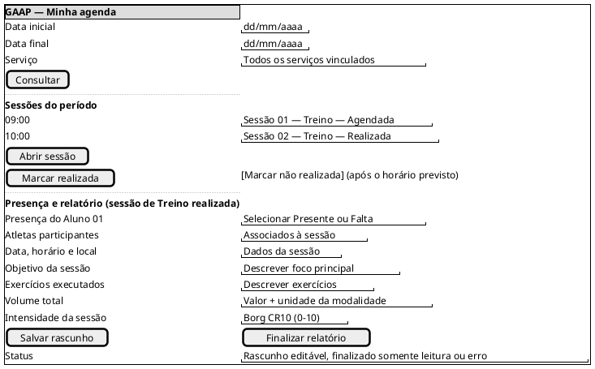
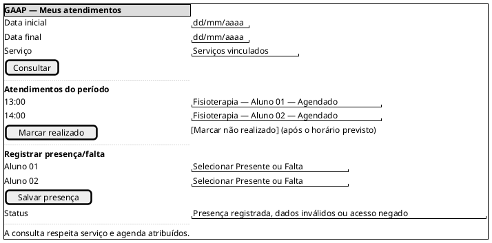

# Protótipo de Baixa Fidelidade — GAAP

Este protótipo de navegação usa os perfis do cenário GAAP e os IDs RF do [levantamento](../Elaboracao/levreq.md). É uma proposta de telas para uma API consumida por cliente web; a interface não faz parte da entrega do backend. Campos ainda não definidos pelo cenário estão identificados como pendentes.

## Mapa das telas

| Tela | Perfil | Requisitos | Ações principais |
|---|---|---|---|
| Acesso | Todos | RF-01 | Autenticar; apresentar acesso negado. |
| Cadastros | Administrador | RF-02 | Manter aluno, profissional e serviço. |
| Visão geral e pendências | Administrador | RF-04, RF-09, RF-11 | Consultar a operação e as pendências; representar os filtros de RF-09 e o dashboard de RF-11 já definido. |
| Agenda e configuração | Administrador | RF-03, RF-04, RF-05 | Consultar disponibilidade/bloqueios e confirmar agendamento sem conflito do profissional ou do aluno. |
| Agenda pessoal | Treinador | RF-04, RF-10 | Consultar sessões sob sua responsabilidade e serviços vinculados; registrar se foram ministradas após o horário previsto. |
| Atendimentos | Profissional de Saúde | RF-04, RF-06, RF-10 | Consultar serviços e agenda atribuídos; registrar presença/falta por aluno e se o atendimento foi ministrado, em ações separadas. |
| Presença e relatório | Treinador; Profissional de Saúde (presença nos atendimentos) | RF-06, RF-07 | Registrar presença/falta em sessões e atendimentos; Treinador finaliza relatório de treino. |
| Aviso de sessão pendente | Treinador | RF-08 (fora do escopo) | Receber o aviso excepcional por e-mail. |

## Acesso — RF-01

## Cadastros — Administrador — RF-02

## Visão geral e pendências — Administrador — RF-04, RF-09, RF-11

Os critérios de RF-09 e RF-11 foram definidos no registro de decisões D-11, D-12 e D-15. O protótipo ainda precisa mostrar os filtros de pendência e os controles de período e agrupamento do dashboard.

## Agenda e confirmação — Administrador — RF-03, RF-04, RF-05

Ao confirmar, a API também verifica se algum aluno participante já tem compromisso sobreposto e aplica o limite informado de 6 alunos por sessão. Essas verificações não são campos adicionais da tela.

## Agenda do Treinador — RF-04, RF-06, RF-07, RF-10

O registro de sessão ministrada é separado da presença/falta e só fica disponível após o horário previsto.

## Atendimentos do Profissional de Saúde — RF-04, RF-06, RF-10

O registro de atendimento ministrado é separado da presença/falta e só fica disponível após o horário previsto.

## Referência visual — protótipo de alta fidelidade

As telas abaixo são os exports atuais de alta fidelidade. Os wireframes PlantUML acima continuam sendo a referência de baixa fidelidade; as imagens ilustram o escopo e os critérios definidos, mas não cobrem todos os estados necessários. Os exports mostram exemplos de presença/falta em atendimentos e os campos definidos para o relatório de treino, com ações de rascunho e finalização. Foi acrescentada uma variante de recusa de agendamento para desktop e mobile: ambas mostram indisponibilidade, conflito, bloqueio e incompatibilidade; o desktop também explicita capacidade excedida, enquanto o mobile mostra o limite de seis alunos por sessão. **Ainda faltam estados de sucesso/erro para outros fluxos, uma visualização separada do relatório finalizado somente para leitura e as representações visuais de RF-10 e RF-11.** O arquivo editável está no [Figma](https://www.figma.com/design/7a3PVqNYNlwLtSgN4sfiU4/GAAP-%E2%80%94-Protótipo-de-alta-fidelidade).

| Export atual | IDs relacionados | Cobertura ainda necessária |
|---|---|---|
| Acesso | RF-01 | Estados de credencial inválida e acesso negado. |
| Visão geral | RF-04, RF-09, RF-11 | Pendências conforme critério definido; filtros de tipo, período e agrupamentos do dashboard por serviço/situação ainda precisam de representação visual. |
| Cadastros | RF-02 | Formulário, validação e confirmação. |
| Novo agendamento e recusa | RF-03, RF-05 | A variante desktop mostra capacidade excedida (7/6); ambas mostram indisponibilidade, bloqueio, conflito e incompatibilidade. A configuração de disponibilidade/bloqueios e o estado de sucesso ainda precisam de representação. |
| Agenda do Treinador | RF-04, RF-06, RF-07, RF-10 | Estado finalizado somente para leitura e erros; representação de realizado/não realizado separada da presença ainda falta. |
| Atendimentos de saúde | RF-04, RF-06, RF-10 | Estado salvo e erros da presença/falta; representação de realizado/não realizado separada da presença ainda falta. |

=== "Desktop · 1920 × 1080"

    ### Acesso — RF-01

    { width="100%" }

    ### Visão geral — RF-04, RF-09, RF-11 (parcial)

    { width="100%" }

    ### Cadastros — RF-02 (parcial)

    { width="100%" }

    ### Novo agendamento — RF-03, RF-05

    { width="100%" }

    ### Recusa do agendamento (variante)

    { width="100%" }

    ### Agenda do treinador — RF-04, RF-06, RF-07, RF-10 (parcial)

    { width="100%" }

    ### Atendimentos de saúde — RF-04, RF-06, RF-10 (parcial)

    { width="100%" }

=== "Mobile · 390 × 844"

    ### Acesso — RF-01

    { width="390" }

    ### Visão geral — RF-04, RF-09, RF-11 (parcial)

    { width="390" }

    ### Cadastros — RF-02 (parcial)

    { width="390" }

    ### Novo agendamento — RF-03, RF-05

    { width="390" }

    ### Recusa do agendamento (variante)

    { width="390" }

    ### Agenda do treinador — RF-04, RF-06, RF-07, RF-10 (parcial)

    { width="390" }

    ### Atendimentos de saúde — RF-04, RF-06, RF-10 (parcial)

    { width="390" }

## Decisões que afetam as telas

- O professor informou capacidade máxima de 6 alunos por sessão, válida para qualquer serviço conforme esclarecimento de Pedro Lucas; no MVP, a validação usará uma constante no backend, sem configuração administrativa.
- Após a finalização, o relatório fica bloqueado para edição; rascunhos podem ser alterados antes de finalizar.
- A interface é representativa; a experiência visual não foi validada com usuários.
- A notificação por e-mail é RF-08, uma exceção registrada fora do escopo no cenário GAAP.

## Referências

- [Glossário](../Elaboracao/glossario.md)
- [Documento de Visão](documento_de_visao.md)
- [Levantamento de Requisitos](../Elaboracao/levreq.md)
- [Casos de Uso](../Elaboracao/casos_de_uso.md)
